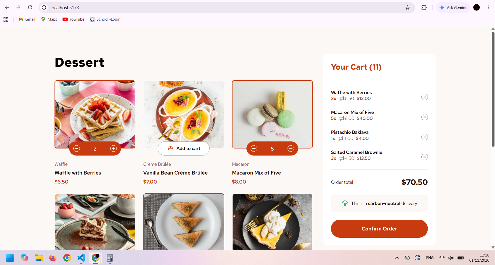

# Product List with Cart

A responsive product listing application built with React and SCSS. 
Users can browse desserts, add products to their cart, adjust quantities, remove items, and confirm their order.

## Overview

### The challenge

The goal was to build a responsive product list with a functional shopping cart.

Users can:

- Add products to the cart and remove them.
- Increase or decrease product quantities.
- View the total number of items and the order total.
- See an order confirmation modal.
- Start a new order and reset the cart.
- Navigate interactive elements using hover and keyboard focus states.
- View a responsive layout across different screen sizes.

### Screenshot

### Links

- Solution URL: [GitHub Repository](https://github.com/Selessawy01/product-list-with-cart.git)
- Live Site URL: [Live Demo] Coming Soon.

## My Process

### Built With

- Semantic HTML5
- React
- JavaScript (ES6+)
- SCSS (Sass)
- CSS Flexbox
- CSS Grid
- Responsive design
- Mobile-first workflow
- Vite

### What I Learned

Building this project helped me improve my understanding of React and component-based development.

Some of the key things I learned include:

- **React state management:** Managing shared cart state in the parent component and passing data and event handlers to child components using props.
- **Array methods:** Using `map()`, `filter()`, and `reduce()` to update cart quantities, remove products, and calculate the order total.
- **Component organization:** Breaking the application into smaller, reusable components such as the product list, cart, and order confirmation modal.
- **SCSS architecture:** Organizing styles into partials, using reusable variables, and following BEM naming conventions.
- **Accessibility:** Improving keyboard navigation with visible focus states, accessible button labels, and focus management for the confirmation modal.

### Continued Development

I want to continue improving my React skills, especially in:

- Managing state and understanding how components communicate through props.
- Writing cleaner and more maintainable JavaScript.
- Improving accessibility, including keyboard navigation and focus management.
- Building responsive layouts and organizing SCSS efficiently.

I also want to keep practicing by converting more Frontend Mentor challenges into React projects.

### Useful Resources

- [React Documentation](https://react.dev/learn) - Helped me understand React components, props, state, and sharing state between components.
- [Sass Documentation](https://sass-lang.com/documentation/) - Useful for learning how to organize SCSS, use variables, and work with partials.
- [MDN Web Docs](https://developer.mozilla.org/) - A helpful reference for JavaScript, CSS, HTML, and accessibility.
- [Frontend Mentor](https://www.frontendmentor.io/) - Provided the design challenge and an opportunity to practice building a realistic project.

### AI Collaboration

I used ChatGPT as a learning and debugging assistant throughout this project.

I used it to:

- Review my React component structure and suggest improvements.
- Understand React state management, props, and event handlers.
- Debug issues and understand why certain changes were needed.
- Review my SCSS organization and BEM naming conventions.
- Improve accessibility, including keyboard navigation, focus management, and modal behavior.
- Get feedback on code quality and maintainability.

I wrote and developed the application myself, using AI guidance to better understand concepts, solve problems, and improve my code.

This process helped me learn not only how to make the application work, but also how to write cleaner and more accessible code.

## Author

- Frontend Mentor - [@yourusername](https://www.frontendmentor.io/profile/Selessawy01)

- GitHub - [@yourusername](https://github.com/Selessawy01)

## Acknowledgments

- [Frontend Mentor](https://www.frontendmentor.io/) for providing the challenge and design resources.
- The React and Sass documentation for helping me understand the technologies used in this project.

